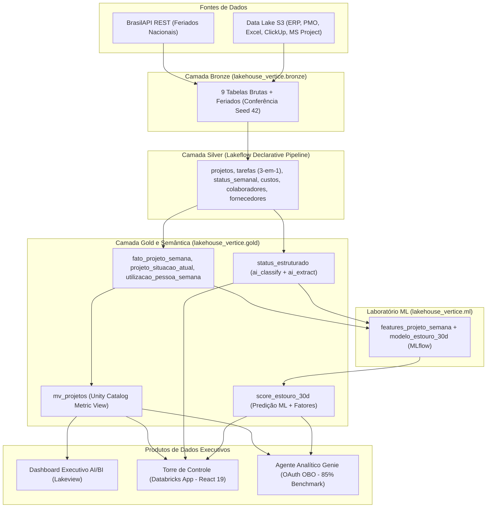
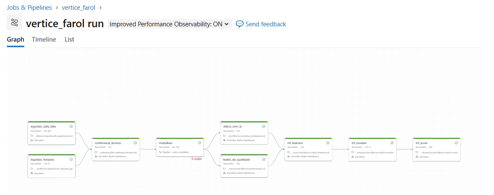
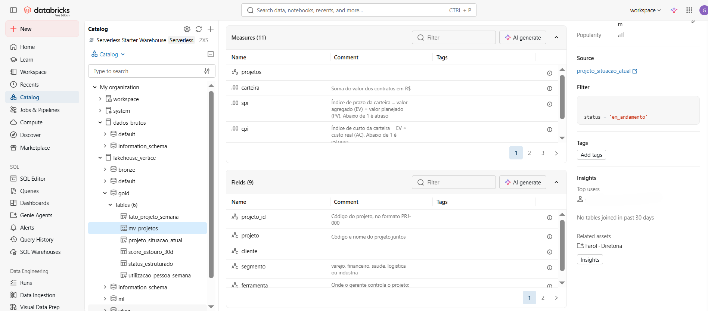
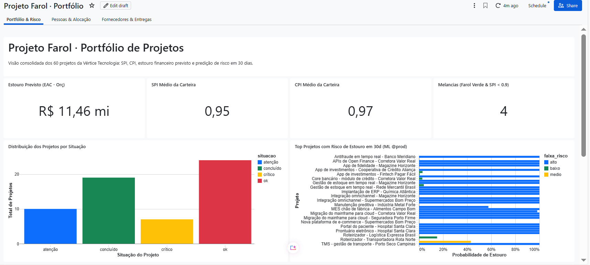
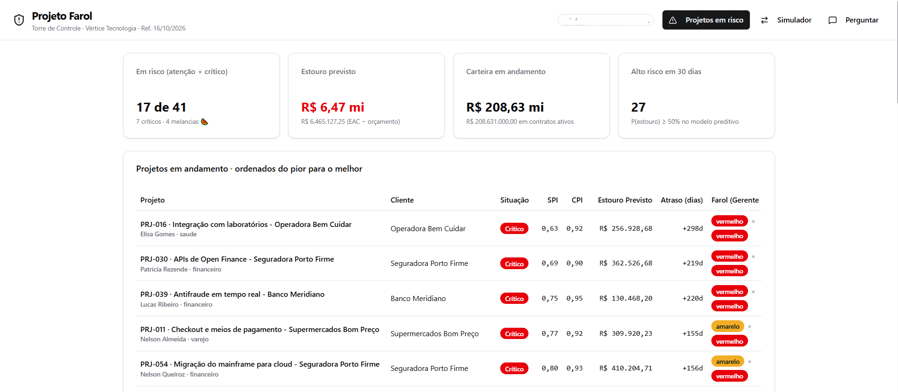
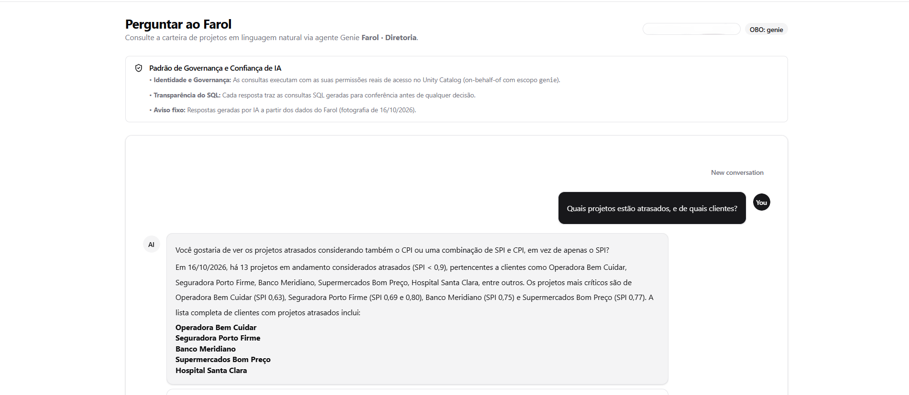
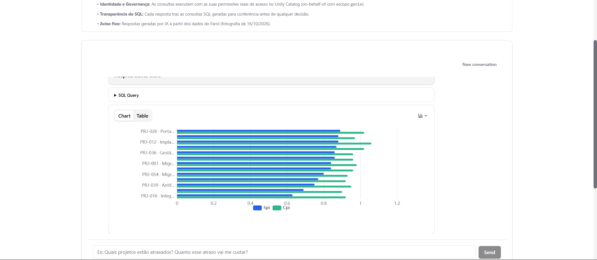

# Farol · Enterprise Lakehouse Control Tower (Vértice Tecnologia)


> **Plataforma Corporativa de Inteligência de Portfólio, Governança Semântica, IA Generativa e Machine Learning Preditivo construída 100% sobre o Databricks Data Intelligence Platform.**

---

## 1. Visão Geral & Problema de Negócio

A **Vértice Tecnologia** é uma consultoria de engenharia de software e dados com **520 colaboradores** e uma carteira de **60 projetos corporativos** (sendo **41 em andamento** na data-base de `16/10/2026` e **R$ 193,35 milhões** em custos acumulados).

Com o crescimento acelerado da operação nos segmentos de **Varejo, Financeiro, Saúde, Logística e Indústria**, a diretoria executiva e o PMO enfrentavam quatro grandes gargalos operacionais e financeiros:

1. **Fragmentação de Ferramentas de Gestão**: Cada gerente conduzia o cronograma de seu projeto em uma ferramenta distinta — **20 projetos em planilhas Excel**, **25 no ClickUp** e **15 no MS Project (XML)** — com esquemas incompatíveis, datas em formatos mistos (números de série do Excel, timestamps em milissegundos, strings ISO/BR) e durações em formato ISO-8601 (`PT40H0M0S`).
2. **Assimetria de Informação e "Projetos Melancia"**: Às sextas-feiras, gerentes reportavam um farol subjetivo (`verde`, `amarelo`, `vermelho`). Projetos apareciam **"verdes por fora, mas vermelhos por dentro"** (*Projetos Melancia*): reportados como verdes pelo gerente, mas com **Índice de Performance de Prazo (`SPI`) abaixo de `0,90`** quando confrontados com as horas agregadas das tarefas reais.
3. **Causas de Atraso Escondidas em Texto Livre**: O motivo real pelo qual um projeto travava (*falta de SRE, change freeze do cliente, dependência da consultoria terceirizada CodeForge, rotatividade da squad ou mudança de escopo sem aditivo*) ficava enterrado em mais de **3.900 relatórios semanais de status** redigidos em português livre.
4. **Gestão Reativa em vez de Preditiva e Má Alocação de Squads**: A regra de corte tradicional (`SPI < 0,90` ou `CPI < 0,90`) só acendia o alerta **depois** que o projeto já havia estourado prazo ou orçamento, enquanto especialistas sêniores permaneciam com ociosidade superior a 80% em outras frentes.

O **Projeto Farol (Lakehouse Control Tower)** resolve esses desafios unificando ingestão multi-fonte, arquitetura Medalhão declarativa, extração estruturada com IA Generativa, camada semântica governada no Unity Catalog, escoragem preditiva de risco para os próximos 30 dias e três produtos de dados integrados (**Dashboard AI/BI**, **Databricks App** e **Agente Analítico Genie**).

---

## 2. Arquitetura da Solução

A plataforma foi projetada seguindo os padrões de **Staff Analytics Engineering** no catálogo `lakehouse_vertice` do **Unity Catalog**, combinando **Lakeflow Spark Declarative Pipelines (Serverless + Photon)**, **Databricks AI Functions**, **MLflow** e **Databricks Asset Bundles (DABs)**.



### Fluxo Medalhão Detalhado (`Bronze` → `Silver` → `Gold`)

| Camada | Objetos Principais | Responsabilidade Técnica e Regras de Engenharia |
| :--- | :--- | :--- |
| **Bronze** (`lakehouse_vertice.bronze`) | `projetos`, `status_semanal`, `excel_tarefas`, `clickup_tarefas`, `msproject_tarefas`, `colaboradores`, `apontamentos`, `custos`, `entregas_fornecedor`, `feriados` | Ingestão fiel da API REST de feriados ([`01_ingestao_api.ipynb`](src/ingestao/01_ingestao_api.ipynb)) e do Object Storage compatível com S3 via `boto3` ([`02_ingestao_boto3.ipynb`](src/ingestao/02_ingestao_boto3.ipynb)), seguida pela trava de volumetria exata ([`00-conferencia-bronze.sql`](src/conferencia/00-conferencia-bronze.sql)). |
| **Silver** (`lakehouse_vertice.silver`) | `projetos`, `tarefas`, `status_semanal`, `custos`, `colaboradores`, `apontamentos`, `entregas_fornecedor` | Pipeline declarativo serverless ([`vertice_medalhao.pipeline.yml`](resources/vertice_medalhao.pipeline.yml)) que resolve **12 anomalias estruturais** dos sistemas de origem e aplica *Data Quality Expectations* (`CONSTRAINT ... ON VIOLATION FAIL UPDATE`). Unifica Excel, ClickUp e MS Project em um modelo único de tarefas (`silver.tarefas`), deduplica os 520 colaboradores e padroniza razões sociais de fornecedores (ex.: unificação das variações da *CodeForge Consultoria Ltda*). |
| **Gold** (`lakehouse_vertice.gold`) | `fato_projeto_semana`, `projeto_situacao_atual`, `utilizacao_pessoa_semana`, `status_estruturado`, `score_estouro_30d`, `mv_projetos` | Modelagem dimensional e de **Gerenciamento de Valor Agregado (EVM)** toda sexta-feira até `2026-10-16` ([`01-fato-projeto-semana.sql`](src/gold/01-fato-projeto-semana.sql)), fotografia executiva consolidada e análise de ociosidade ([`02-situacao-e-pessoas.sql`](src/gold/02-situacao-e-pessoas.sql)), enriquecimento semântico com IA Generativa e escoragem preditiva de risco. |

---

## 3. Pipeline de Dados & Orquestração (`vertice_farol`)

Todo o pipeline dos dados é orquestrado pelo Databricks Workflow **`vertice_farol`** ([`resources/vertice.job.yml`](resources/vertice.job.yml)), composto por **10 tarefas encadeadas em DAG** com execução agendada às segundas-feiras (`0 0 6 ? * MON`, `America/Sao_Paulo`):



### Etapas da DAG, Qualidade de Dados e Classificação com IA

1. **`ingestao_feriados` & `ingestao_data_lake`**: Execução paralela dos notebooks de ingestão para carregar calendários oficiais e as 9 tabelas brutas do Data Lake S3.
2. **`conferencia_bronze`** ([`src/conferencia/00-conferencia-bronze.sql`](src/conferencia/00-conferencia-bronze.sql)): Valida a contagem exata das 9 tabelas brutas (60 projetos, 3.911 status semanais, 30.883 apontamentos, 23.640 lançamentos de custo, etc.) interrompendo imediatamente o pipeline com `raise_error()` em caso de divergência.
3. **`medalhao`** ([`resources/vertice_medalhao.pipeline.yml`](resources/vertice_medalhao.pipeline.yml)): Atualiza todas as Materialized Views das camadas `silver` e `gold` utilizando **Lakeflow Spark Declarative Pipelines** em compute **Serverless com Photon habilitado**.
4. **`testes_de_qualidade`** ([`src/testes/testes.sql`](src/testes/testes.sql)): Bateria de **10 testes automatizados de engenharia e reconciliação contábil** executados no SQL Warehouse com `raise_error()`:
   - Garantia de que todos os 60 projetos possuem cronograma íntegro em `silver.tarefas` e vêm exclusivamente da ferramenta cadastrada pelo PMO.
   - Reconciliação das horas de tarefas do Excel contra as linhas de `TOTAL` originais da Bronze.
   - Unicidade de 520 colaboradores em `silver.colaboradores` e unificação cadastral da *CodeForge Consultoria Ltda*.
   - Preservação exata do custo total entre Bronze e Silver (**R$ 193,35 milhões**) e reconciliação entre `AC` acumulado na fato semanal e soma dos lançamentos em `silver.custos`.
   - Consistência entre o Valor Agregado (`EV`) calculado pelas ferramentas e o `EV` reportado nos boletins semanais (divergência `< 1%`).
5. **`status_com_ia`** ([`src/ia/status_estruturado.sql`](src/ia/status_estruturado.sql)): Transforma o texto livre dos gerentes na tabela estruturada `gold.status_estruturado` combinando **três estratégias para otimização de custo e latência**:
   - **Regra Determinística** (custo zero): Filtra relatórios vazios ou explicitamente sem bloqueios (`bloqueios: nenhum`, `sem bloqueios`, `nada relevante`).
   - **Databricks AI Functions (`ai_classify` + `ai_extract`)**: Aplicadas aos relatórios com bloqueio dos últimos 90 dias, classificando a causa raiz em taxonomia fechada (`change_freeze`, `falta_sre`, `dependencia_fornecedor`, `rotatividade`, `mudanca_escopo`, `bug_retrabalho`, `aprovacao_cliente`, `sem_bloqueio`) e extraindo um objeto tipado JSON com `bloqueio`, `quem_destrava` e `dias_impacto`.
   - **Expressões Regulares (`RLIKE`)**: Classifica o histórico antigo onde chamadas de LLM não alterariam decisões operacionais.
   - **Idempotência Incremental**: Utiliza `LEFT ANTI JOIN` + `MERGE INTO` para processar apenas novos boletins a cada execução semanal.
6. **`metricas_governadas`**, **`ml_features`**, **`ml_modelo`** e **`ml_score`**: Publicam a camada semântica e executam o ciclo completo de treinamento, validação, registro e inferência do modelo preditivo.

---

## 4. Camada Semântica & Governança (`Unity Catalog Metric View`)

Para eliminar divergências de cálculo entre dashboards, relatórios financeiros e perguntas feitas ao agente de IA, todas as fórmulas de negócio foram centralizadas na **Metric View `lakehouse_vertice.gold.mv_projetos`** ([`src/metricas/metricas.sql`](src/metricas/metricas.sql)), utilizando a especificação nativa `WITH METRICS LANGUAGE YAML` (versão 1.1) do Unity Catalog:



### Principais Métricas Governadas

| Métrica | Expressão Governada (YAML / SQL) | Significado Executivo |
| :--- | :--- | :--- |
| **`carteira`** | `SUM(valor_contrato)` | Receita total contratada dos projetos ativos em R$. |
| **`spi`** (*Schedule Performance Index*) | `SUM(ev) / SUM(pv)` | Eficiência de cronograma da carteira: Valor Agregado (`EV`) dividido pelo Valor Planejado (`PV`). Abaixo de `1,00` indica atraso. |
| **`cpi`** (*Cost Performance Index*) | `SUM(ev) / SUM(ac)` | Eficiência de custo da carteira: Valor Agregado (`EV`) dividido pelo Custo Real (`AC`). Abaixo de `1,00` indica sobrecusto. |
| **`eac`** (*Estimate at Completion*) | `SUM(eac)` onde `eac = orcamento / cpi` | Custo total projetado no término de cada projeto mantendo o ritmo atual de eficiência. |
| **`estouro_previsto`** | `SUM(estouro_previsto)` | Soma de `GREATEST(eac - orcamento, 0)` — impacto financeiro direto de sobrecusto previsto em R$. |
| **`margem_projetada`** | `(SUM(valor_contrato) - SUM(eac)) / SUM(valor_contrato)` | Margem bruta percentual projetada da carteira após absorver os estouros estimados. |
| **`projetos_em_risco` / `projetos_criticos`** | `COUNT(1) FILTER (WHERE situacao IN ('atenção', 'crítico'))` | Projetos que violaram os limites operacionais (` < 0,90` para atenção; `< 0,80` para crítico). |
| **`projetos_melancia`** | `COUNT(1) FILTER (WHERE melancia)` | Projetos reportados como **verdes** pelo gerente no último status, mas com **`SPI < 0,90`** no cronograma real. |

> Consulte o dicionário completo de fórmulas e dimensões em [`src/metricas/README.md`](src/metricas/README.md).

---

## 5. Machine Learning Preditivo (Risco de Estouro em 30 Dias)

A regra de corte tradicional (`SPI < 0,90` ou `CPI < 0,90`) possui **antecedência zero**: ela só alerta quando o projeto já cruzou a linha de risco. Para antecipar quais projetos saudáveis (`SPI >= 0,90` e `CPI >= 0,90`) entrarão em atenção ou criticidade nas próximas **4 semanas (30 dias)**, foi construído o pipeline preditivo em [`src/ml/`](src/ml/):

### 1. Engenharia de Features Point-in-Time ([`src/ml/01-features.sql`](src/ml/01-features.sql))
A tabela `lakehouse_vertice.ml.features_projeto_semana` calcula **24 variáveis explicativas** por projeto e semana olhando **estritamente para o passado** (evitando *data leakage*):
- **Posição Atual**: `spi`, `cpi`, `indice_min` (`LEAST(spi, cpi)`), avanço físico (`pct_fisico`) e avanço temporal (`pct_prazo`).
- **Velocidade e Aceleração Recente (4 e 8 semanas)**: Variações `d_spi_4s`, `d_cpi_4s`, `d_spi_8s`, `d_cpi_8s`, `d_indice_min_4s`, contagem de quedas consecutivas (`semanas_cpi_caindo`) e índices marginais do último mês (`cpi_ultimas_4s`, `spi_ultimas_4s`).
- **Pessoas e Composição de Custos**: Taxa de horas paradas (`ociosidade_4s`), peso de terceiros e nuvem nos custos recentes (`pct_consultoria_4s`, `pct_cloud_4s`) e desligamentos na squad nas últimas 12 semanas (`saidas_12s`).
- **Sinais Extraídos por IA dos Relatórios Semanais**: Frequência nas últimas 4 semanas de bloqueios classificados como `status_freeze_4s`, `status_falta_sre_4s`, `status_fornecedor_4s`, `status_rotatividade_4s`, `status_escopo_4s`, `status_retrabalho_4s` e `status_com_bloqueio_4s`.

### 2. Treinamento Temporal, Baselines e Registro no Unity Catalog ([`src/ml/02-modelo.py`](src/ml/02-modelo.py))
- **Abordagem Híbrida Regressão → Probabilidade**: Em vez de um classificador binário caixa-preta, um `HistGradientBoostingRegressor` prevê **quanto o pior índice (`min(SPI, CPI)`) cairá nas próximas 4 semanas**. A probabilidade de estouro `P(pior_indice_30d < 0,90)` é derivada analiticamente via distribuição normal calibrada pelo desvio padrão residual (`sigma`) medido no conjunto de teste temporal (`semana >= 2026-04-03`, com *gap* de 4 semanas após o corte de treino em `2026-03-06`).
- **4 Travas Automatizadas de Qualidade do Modelo (`assert`)**: Antes de promover qualquer versão para produção, o notebook exige:
  1. `auc_modelo >= 0.75` (piso mínimo de discriminação do PRD);
  2. `auc_modelo < 0.98` (proteção automática contra vazamento de dados / *target leakage*);
  3. `auc_modelo >= melhor_baseline` (superar a régua heurística de folga até o corte de `0,90`);
  4. `len(avisados) >= 0.70 * len(eventos)` (alertar pelo menos **70% dos estouros reais** no Top 5 semanal com semanas de antecedência).
- **Governança MLflow + Unity Catalog**: O modelo aprovado é registrado em `lakehouse_vertice.ml.modelo_estouro_30d` com o alias **`@prod`**, e seus metadados de auditoria são persistidos em `lakehouse_vertice.ml.modelo_metricas`.

### 3. Escoragem em Lote e Explicabilidade Executiva ([`src/ml/03-score.py`](src/ml/03-score.py))
Carrega `models:/lakehouse_vertice.ml.modelo_estouro_30d@prod`, pontua todos os projetos em andamento e grava `lakehouse_vertice.gold.score_estouro_30d` com:
- `prob_estouro_30d` (`0,0` a `1,0`), `ranking` (`1` = maior risco) e `faixa_risco` (`alto >= 0,50`, `medio >= 0,20`, `baixo < 0,20`);
- **`principais_fatores`**: Tradução automática dos sinais numéricos do projeto em **frases acionáveis em português** para a reunião de segunda-feira (ex.: *"CPI caindo há 3 de 4 semanas (-0,042); falta de SRE em 2 dos últimos 4 status; squad perdendo gente: 2 saídas em 12 semanas"*).

---

## 6. Produtos de Dados

### 6.1. Dashboard Executivo AI/BI (Lakeview)
Construído declarativamente e versionado em [`resources/dashboard-portfolio.lvdash.json`](resources/dashboard-portfolio.lvdash.json) (gerado via [`scripts/gerar_dashboard.py`](scripts/gerar_dashboard.py)), entrega à diretoria:
- **Cards Executivos de KPIs**: Carteira ativa, total de projetos em risco/críticos, projetos melancia, estouro total previsto e margem projetada.
- **Matriz de Dispersão (`SPI` × `CPI`)**: Identificação visual imediata de projetos atrasados e acima do custo por segmento e ferramenta.
- **Matriz de Risco e Decomposição de Sobrecusto**: Ranking detalhado por gerente de projeto, cliente e causas de bloqueio.



---

### 6.2. Databricks App — Torre de Controle (`minha-torre`)
Aplicação web executiva full-stack em **React 19 + TypeScript + Tailwind CSS v4 + Node.js (`@databricks/appkit`)** hospedada nativamente no **Databricks Apps** ([`minha-torre/`](minha-torre/)):
- **Visão Consolidada da Carteira & Filtros Inteligentes**: Monitoramento em tempo real de contratos, estouros previstos, atraso projetado, farol reportado vs. farol calculado e flag de *Projeto Melancia*.
- **Radar Preditivo de 30 Dias (ML)**: Integração direta com `gold.score_estouro_30d`, destacando os projetos com maior probabilidade de cruzar o limite de `0,90` no próximo mês e exibindo os **principais fatores explicativos**.
- **Simulador de Realocação de Squad & Ociosidade**: Cruza projetos travados por *Falta de SRE* ou *Rotatividade* com colaboradores que apresentam **utilização média inferior a 20% nas últimas 12 semanas** (`gold.utilizacao_pessoa_semana`), permitindo simular o impacto financeiro e operacional do remanejamento interno antes de contratar consultorias externas.



> Documentação completa da arquitetura do App disponível em [`minha-torre/README.md`](minha-torre/README.md).

---

### 6.3. Agente Analítico Genie (`Farol · Diretoria`)
Espaço conversacional NL2SQL configurado em [`resources/farol.geniespace.json`](resources/farol.geniespace.json) sobre a Metric View `gold.mv_projetos` e as tabelas Gold, integrado diretamente à aba **"Perguntar"** da Torre de Controle via componente `<GenieChat />`:
- **Autenticação OAuth On-Behalf-Of (OBO)**: Configurada em [`minha-torre/app.yaml`](minha-torre/app.yaml) e [`minha-torre/databricks.yml`](minha-torre/databricks.yml) com os escopos `genie` e `dashboards.genie`, garantindo que cada pergunta feita no App respeite as permissões do usuário logado no Unity Catalog.
- **Engenharia de Contexto e Benchmark de 85% de Acurácia**: O espaço Genie foi instruído com regras de negócio da Vértice, sinônimos semânticos e exemplos SQL certificados, sendo validado pelo utilitário de linha de comando [`scripts/genie.py`](scripts/genie.py) (que compara os data arrays retornados pelo Genie contra queries SQL de referência no SQL Warehouse), alcançando **85% de acurácia nos benchmarks executivos**.





---

## 7. Estrutura do Repositório

```text
databricks-lakehouse-control-tower/
├── databricks.yml                      # Configuração raiz do Databricks Asset Bundle (DABs)
├── pyproject.toml                      # Dependências Python (Databricks Connect, DLT, Ruff, Pytest)
├── docs/assets/                        # Capturas de tela da arquitetura, pipeline, UC, dashboard e App
├── resources/                          # Definições declarativas de recursos Databricks
│   ├── vertice.job.yml                 # Job orquestrador vertice_farol (DAG de 10 tasks)
│   ├── vertice_medalhao.pipeline.yml   # Pipeline Lakeflow Spark Declarative (Serverless + Photon)
│   ├── dashboard.dashboard.yml         # Recurso do Dashboard AI/BI Lakeview
│   ├── dashboard-portfolio.lvdash.json # Definição JSON do Dashboard Executivo
│   ├── genie.genie_space.yml           # Recurso do Databricks Genie Space
│   └── farol.geniespace.json           # Instruções, tabelas e SQLs certificados do Genie
├── src/                                # Código-fonte de Engenharia de Dados, IA e ML
│   ├── ingestao/                       # Notebooks de ingestão (BrasilAPI REST e S3 via boto3)
│   ├── conferencia/                    # Validação de volumetria da camada Bronze (Seed 42)
│   ├── silver/                         # Limpeza das 12 sujeiras e unificação das 3 ferramentas
│   ├── gold/                           # Modelagem EVM semanal, fotografia atual e utilização de pessoas
│   ├── testes/                         # 10 testes de qualidade e reconciliação com raise_error()
│   ├── ia/                             # Extração estruturada de status com ai_classify() e ai_extract()
│   ├── metricas/                       # Metric View governada (gold.mv_projetos) + README de KPIs
│   └── ml/                             # Feature engineering, treino MLflow (@prod) e batch scoring
├── scripts/                            # Automação de deploy, permissões UC e benchmark do Genie
│   ├── conceder-acesso.sh              # Grants do Unity Catalog para o Service Principal do App
│   ├── genie.py                        # CLI para publicação, perguntas e benchmark automatizado do Genie
│   ├── gerar_dashboard.py              # Gerador programático do AI/BI Dashboard (.lvdash.json)
│   ├── gerar_genie.py                  # Gerador programático do Genie Space (.geniespace.json)
│   └── run_sql.py                      # Executor de scripts SQL via Databricks SDK / CLI
└── minha-torre/                        # Aplicação Full-Stack (Databricks App em React 19 + AppKit)
    ├── app.yaml                        # Manifesto de runtime, env vars e escopos OAuth OBO
    ├── databricks.yml                  # Bundle de deploy do Databricks App e vínculo de recursos
    ├── config/queries/                 # Queries SQL analíticas parametrizadas (KPIs, risco, ociosidade)
    ├── server/server.ts                # Backend Node/Express (@databricks/appkit + endpoint ML score)
    └── client/                         # Frontend React 19 + TypeScript + Tailwind CSS v4 + GenieChat
```

---

## 8. Guia de Implantação e Execução Local (Databricks Asset Bundles)

### Pré-requisitos
- **Databricks CLI** (`>= 0.220.0`) autenticado no workspace alvo (`databricks auth login --host <WORKSPACE_URL>`).
- **Python 3.12+** e **Node.js 22+ / npm 11+** (para desenvolvimento local da aplicação `minha-torre`).
- Um **SQL Warehouse Serverless** ativo no workspace.

### Passo 1 — Configurar Variáveis e Credenciais Locais
As chaves de leitura do Data Lake S3 não ficam versionadas no Git. Crie o arquivo local `.databricks/bundle/dev/variable-overrides.json`:

```json
{
  "catalog": "lakehouse_vertice",
  "warehouse_id": "<SEU_SQL_WAREHOUSE_ID>",
  "s3_access_key_id": "<SUA_S3_ACCESS_KEY_ID>",
  "s3_secret_access_key": "<SUA_S3_SECRET_ACCESS_KEY>"
}
```

### Passo 2 — Validar e Implantar o Pipeline, Dashboard e Genie (Raiz)
Na raiz do repositório, valide e publique os recursos do bundle principal (`verticeaovivo`):

```bash
# Validar a sintaxe e referências do bundle
databricks bundle validate -t dev

# Implantar pipeline Lakeflow, Job vertice_farol, Dashboard AI/BI e Genie Space
databricks bundle deploy -t dev

# Disparar a execução completa da DAG (Ingestão -> Bronze -> Silver/Gold -> Testes/IA -> Métricas/ML)
databricks bundle run vertice_farol -t dev
```

### Passo 3 — Implantar o Databricks App (`minha-torre`) e Conceder Acesso ao Unity Catalog
Após a criação das tabelas e métricas governadas no catálogo `lakehouse_vertice`, implante a aplicação web e conceda privilégios de leitura ao Service Principal do App:

```bash
# 1. Implantar o Databricks App via bundle dedicado
cd minha-torre
databricks bundle deploy -t default
cd ..

# 2. Conceder USE CATALOG, USE SCHEMA e SELECT nos schemas gold e silver ao Service Principal do App
bash scripts/conceder-acesso.sh DEFAULT
```

### Passo 4 — Executar Benchmark do Agente Genie (Opcional)
Para testar perguntas em linguagem natural ou aferir o benchmark de precisão do agente Genie via terminal:

```bash
# Fazer perguntas diretamente ao agente Genie
python scripts/genie.py perguntar "Farol · Diretoria" \
  "Quais são os projetos melancia hoje?" \
  "Qual gerente tem o maior estouro previsto na carteira?" \
  --profile DEFAULT
```
